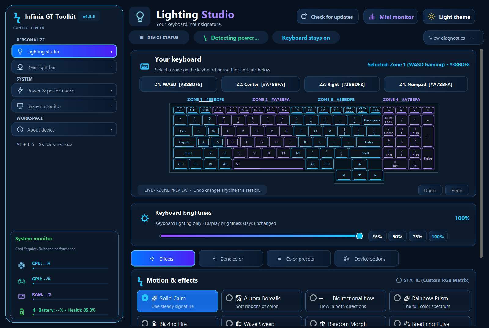
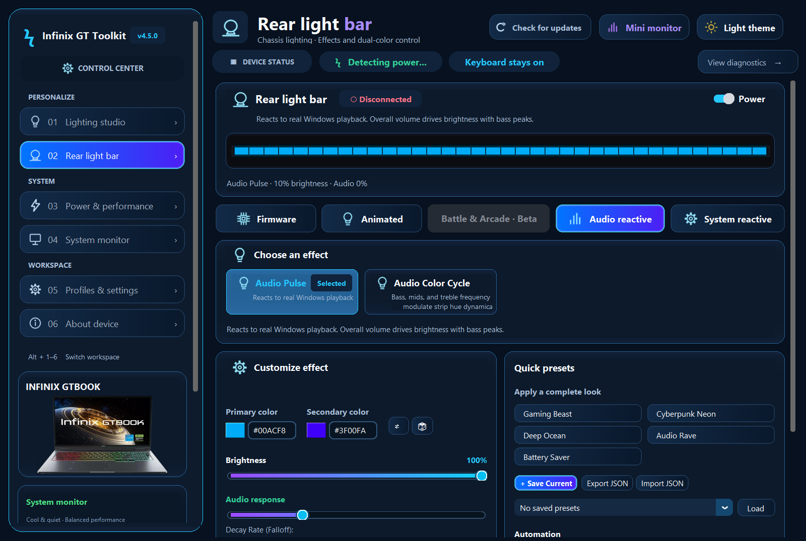

# Infinix GT Book Custom Control Center

An open-source Windows control center for the **Infinix GT Book**, built for owners who want one place to control lighting, performance, cooling, and live hardware monitoring.

Developed by **Yashwant Mandal**, Jharkhand, India.

[Download the latest release](https://github.com/yashwantmandal26/Infinix-GT-Book-Custom-Control-Center/releases/latest) · [Report an issue](https://github.com/yashwantmandal26/Infinix-GT-Book-Custom-Control-Center/issues) · MIT licensed

## Screenshots

### Lighting Studio



### Rear Mecha Bar



## Main features

- **Smart Cooling & Custom Fan Curve Governor**: 6-mode segmented button with interactive 5-point setpoint curve graph, moving-average temperature smoothing, downward anti-hunting hysteresis, and independent CPU/GPU duty cycle control.
- **Dynamic Display Refresh Rate & Battery Intelligence**: Fluid 120Hz native refresh rate switching on AC, automatic 60Hz battery saver mode, 80% charge longevity alert with audio chime, and real-time wattage ($W$) draw metrics.
- **Autonomous Game Sensing & In-Game Floating HUD**: Automatic detection for 30+ popular titles, pre-game hardware state snapshot and 100% clean post-game restoration, plus non-intrusive transparent in-game telemetry overlay (`Ctrl + Shift + O`).
- **Advanced Audio Equalizer 2.0 & Lighting Innovations**: Multi-zone acoustic frequency split (Sub-Bass, Low-Mids, High-Mids, Treble), rear Mecha Bar bass punch, low-overhead screen sync (<1.2ms, <0.5% CPU), and 6 curated designer presets.
- **Production Robustness & Safe Cold-Boot Handshake**: EC Register `0x41=0` handshake on boot to disarm runaway fan blast, ACPI WMI permission shield, and true minimize-to-tray low-idle sleep mode (<0.1% CPU and <45MB RAM).
- **Four-zone keyboard RGB** with independent colours, brightness, speed, direction, and effect controls.
- **Four original keyboard motions**: Magnetic Slingshot, Chromatic Relay, Time Fracture, and Orbital Eclipse.
- **Rear Mecha Bar control** for supported firmware, animated, audio-reactive, and system-reactive modes.
- **Built-in update checks** with release manifest and SHA-256 verification.
- **Dark and light themes** in a single portable desktop application.

> **Battle & Arcade is currently Beta and disabled.** The laptop accepts OEM effects, but its custom per-LED animation protocol is not fully verified. The section is greyed out so users do not select effects that the hardware cannot reproduce correctly.

## How it is made

- **Python 3.12 + CustomTkinter** power the desktop interface.
- Keyboard lighting communicates with the GT Book's **USB HID controller (`340E:8002`)**.
- Rear lighting communicates with the internal **COM/ACPI lighting controller**.
- Performance and telemetry use the available **Windows WMI, EC, power, and sensor interfaces**.
- **PyInstaller** produces the portable Windows executable.
- **pytest and GitHub Actions** validate core behaviour and build tagged releases.

## Supported setup

- Windows 10 or Windows 11
- Infinix GT Book hardware; developed and tested primarily on **GL613 / BYD N16-class hardware**
- Administrator access for hardware controls
- Close the official Infinix Control Center before using this app, so both programs do not compete for the same controller

Hardware revisions may expose different interfaces. Use the diagnostic page when a device is not detected.

## Install and run

1. Open [Releases](https://github.com/yashwantmandal26/Infinix-GT-Book-Custom-Control-Center/releases/latest).
2. Download the portable ZIP and extract it.
3. Run `InfinixGTToolkit.exe` as administrator.

Windows may show an unsigned-app warning because this community build does not currently use a commercial code-signing certificate.

## Edit or build it yourself

```powershell
git clone https://github.com/yashwantmandal26/Infinix-GT-Book-Custom-Control-Center.git
cd Infinix-GT-Book-Custom-Control-Center
powershell -ExecutionPolicy Bypass -File .\scripts\setup-dev.ps1
.\.venv\Scripts\python.exe infinix_toolkit.py
```

Build the executable:

```powershell
powershell -ExecutionPolicy Bypass -File .\scripts\build.ps1
```

Building also updates the main folder's `InfinixGTToolkit.exe` and matching
manifest. If the previous version is running, choose **Exit Toolkit** from its
system-tray menu before reopening the app; the window's X button can hide it.

Run the complete verification suite:

```powershell
powershell -ExecutionPolicy Bypass -File .\scripts\test.ps1
```

## Project map

| Path | Purpose |
|---|---|
| `infinix_toolkit.py` | Main application, hardware engines, version, and update settings |
| `fan_curve_engine.py` | Smart cooling governor, anti-hunting hysteresis, and custom fan curves |
| `display_battery_engine.py` | Dynamic 120Hz/60Hz refresh rate switching, 80% charge health alert, wattage metrics |
| `game_automation_engine.py` | Per-game profile manager (30+ titles) and in-game floating HUD (`Ctrl+Shift+O`) |
| `lighting_engine.py` | Advanced Audio Equalizer 2.0, low-overhead screen sync, and 6 designer presets |
| `backzone_ui.py` | Rear Mecha Bar interface and its available effect categories |
| `studio_ui.py`, `neon_ui.py`, `color_studio.py` | Lighting interface and colour controls |
| `app_runtime.py`, `hardware_runtime.py`, `automation_policy.py` | Runtime and automation services |
| `telemetry_data.py` | Shared read-only sensor snapshots and validated measurement formatting |
| `test_*.py` | Automated tests and hardware-safe protocol checks |
| `scripts/` | Setup, build, test, packaging, and release helpers |
| `docs/` | Screenshots and supporting project material |
| `.github/workflows/` | Automated tagged-release build and publishing |

## Project status

- Current local build: **v5.0.0 Milestone Release**
- Automated validation: **149 tests and 9 subtests passed (100% green)**
- Production readiness: Verified on live Infinix GT Book (GL613 / BYD N16 chassis) with safe cold-boot hardware handshake and zero-fan-surge protection.
- The project is community-made and is not affiliated with Infinix
- Contributions, hardware observations, and reproducible bug reports are welcome

## License

Released under the [MIT License](LICENSE). Third-party components retain their own licenses; see [THIRD_PARTY_NOTICES.md](THIRD_PARTY_NOTICES.md).
